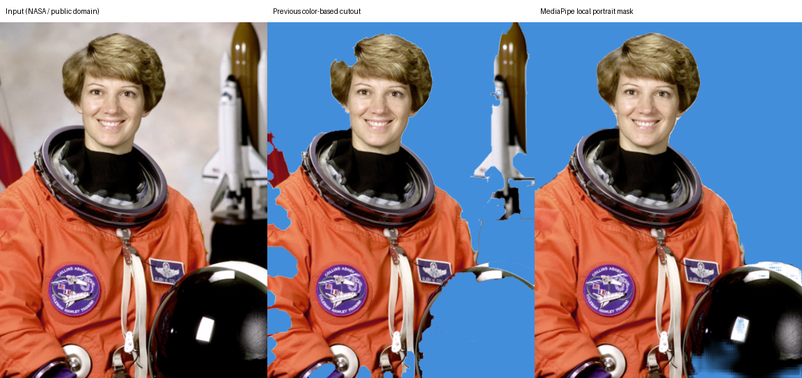

# 自动验证报告

## 自有服务器迁移（2026-11-09）

- 参照解梦项目，默认内容安全后端已切为 `https://www.ai-dreams.xyz/qingtu-api`，新增独立 Express / MySQL 服务、Docker Compose、Nginx 路由及环境变量模板；默认请求链路无需腾讯云开发资源。
- 本地 157 项测试、页面静态校验、模型完整性与安全检查通过，服务端锁文件 `npm ci` 可复现安装，npm 依赖审计未发现漏洞。本地 HTTP 集成测试使用模拟微信 API / 数据存储与真实临时图片文件，不代表已验证微信远程接口或手机原生推理。
- 本地 HTTP 测试覆盖静默登录/JWT、二进制上传、任务归属、重复提交、超大文件、pending、可信加密回调、伪造回调拦截、文件摘要变化、临时签名链接、限流与 TTL 清理；清理失败时健康检查和新图片任务均保持失败。
- 两个项目及服务器上原解梦容器实际使用同一 AppID。只有在该 AppID 完全一致时，部署脚本才允许在服务器内部复用 AppSecret；各服务的 JWT、图片签名密钥与数据库账号分别独立生成。凭据不进入源码、部署包或文档。
- 已部署到 `47.116.65.136:/opt/qingtu-photo-kit`，独立容器 `qingtu-photo-server` 只绑定 `127.0.0.1:3001`，通过 Nginx `/qingtu-api/` 提供 HTTPS，容器健康检查为 healthy。镜像已验证不包含服务器 `.env`。
- 复用宿主机 MySQL 8，但创建独立 `qingtu_photo` 数据库及普通用户。真实 MySQL 冒烟测试通过：JSON 存储、traceId 查询、并发原子状态转换、单次回调记录消费和事务限流；随机探测记录已删除。
- 部署容器内的真实探测通过：公网 HTTPS 健康检查、微信 stable_token 凭据验证、正确签名的 GET challenge 和未签名伪造 POST 回调拒绝。这里的 GET 探测不是微信后台配置成功的证明，也未执行真实图片 `media_check_async` 请求。
- 按用户最新要求，原解梦容器已停止，重启策略为 `no`；旧 HTTPS 根路径返回 410，HTTP 入口重定向 HTTPS，解梦数据库与旧容器保留。Nginx 配置已备份，语法检查通过后重载。
- 微信后台 request 合法域名和可信消息推送配置、真实图片检测回调及真机保存仍待验证。回调凭据仅保存于服务器 `server/.env`；不在文档或聊天中展示。

下面的腾讯云开发记录是迁移前历史，不代表当前默认后端。

## 桌面联调进展（2026-11-09）

- 已连接微信开发者工具，触发编译后首页可正常显示；人像换底色、图片压缩、局部擦除、图片拼接、九宫格切图五个功能页均可打开并返回首页。尚未验证真实图片选取、加工结果、保存或手机原生推理。
- 已查询当前 AppID 绑定环境 `photo-d0gn3yvetb21c4a41` 并填入客户端配置；已部署 `contentSecurity`，云端查询为 `Active`。
- 经用户确认，已删除首次创建的 Node.js 16 函数，在同一环境以同名 Node.js 20.19 普通云函数重建，并重新部署正式代码及云端 npm 依赖。最终 CLI 查询为 `Active`、`Nodejs20.19`、30 秒超时；内存为 256 MB。
- 可信 HTTPS 回调、服务端 Token/AESKey、数据库集合与权限、存储生命周期清理和真实内容安全调用仍未完成验证。云控制台确认当前尚无数据库集合，函数环境变量尚未填写。当前正式代码继续拒绝未配置的请求，部署成功不代表图片链路可用。
- 填入环境 ID 后重新运行静态校验、本地安全检查及 144 项测试，全部通过；原始主包为 624,632 字节。

以下为初始自动验证记录，其中尚未配置云环境的描述由以上进展更新。

验证日期：2026-11-09（北京时间）。本次验证了代码包内模型与 JavaScript 处理链路，**未执行微信后台版本安全校验，未验证微信真机原生推理**。

## 已通过

- `npm run check`：7 个页面静态校验、本地安全约束检查及 144 项测试通过。
- 模型 SHA-256 与清单一致；小程序目录原始文件总量 624,609 字节，低于保守的 2 MiB 主包预算。它不是开发者工具实际压缩包的大小。
- 固定版本模型重建脚本执行成功，重建模型通过 ONNX 图检查和官方输出对照。
- Chromium 中运行官方 MediaPipe JS/WASM；重新采集的参考遮罩与保存的参考图像素一致。
- ONNX 与官方参考输出对照：平均绝对误差约 0.000125，最大误差约 0.02761，二值遮罩 IoU 为 0.999944。这里衡量的是**模型转换一致性**，不是与人工真值对比的人像分割准确率。
- 实际调用小程序的 JavaScript 预处理与后处理，使用 ONNX Runtime CPU 对 NASA 公开人像做一次完整效果回归；热身后 5 次模型推理均值约 5.7 ms，不包含选图、预处理、合成和导出，也不能代表手机耗时。
- 页面测试覆盖模型会话复用、尺寸切换、无模型设备的明确回退、未检测到人像的错误提示及加载期间离页销毁。
- 隐私测试覆盖拒绝后不调用选图/保存、查询失败不绕过检查、自定义弹窗同意/拒绝、页面离开、延迟查询和多接口等待的结算。
- 内容安全测试使用模拟微信 API 与文件/数据库，覆盖来源与结果检测、违规预览/保存拦截、文件摘要变化、pending 超时、回调验签与解密、错误 AppID、重放时间戳、早到回调、重复提交、用户归属、限流及九宫格整批拦截。
- `npm ci --prefix cloudfunctions/contentSecurity` 成功安装锁定的服务端依赖，检查了 SDK 的事务与 `mediaCheckAsync` 接口存在；这不代表已完成真实远程调用。

## 真实样本对照

同一图片先居中裁剪到 3:4，再按小程序的 900×1200 工作尺寸处理。左为原图，中为旧颜色算法，右为端侧人像分割：

| 人工选定的区域 | 旧算法平均 alpha | 新方案平均 alpha |
| --- | ---: | ---: |
| 脸部实心区域 | 1.000 | 1.000 |
| 衣服实心区域 | 1.000 | 1.000 |
| 右侧背景区域 | 0.341 | 0.000 |

alpha 为 0 表示完全透明、1 表示完全保留。这些是局部抽查，不是全图标注。对照图中，新方案清除了旧算法保留的背景物体，并较好保留了头发及主体；仍可见低分辨率模型在复杂物体边缘的局限。

只测试了一张公开照片，不足以推断所有证件照、白衣服、逆光和细发丝的表现。尚无用户反馈的失败原图，无法确认是否覆盖原始效果问题。原始数值见 [portrait-report.json](./validation/portrait-report.json)，样本来源见 `tests/fixtures/README.md`。

## 仍待外部验证

1. **微信内容安全审核**：平台反馈已明确要求证件照功能接入内容安全 API。本次已完成 `mediaCheckAsync` 云函数与客户端接入代码，但尚无云开发环境 ID、实际部署身份和消息推送配置，不能进行真实接口或回调联调。当前未配置环境时图片操作会拦截；下一步见[内容安全部署说明](./内容安全部署.md)。重新提交审核仍未执行。
2. **微信 iOS / Android 真机**：检查本机推理是否实际启用、耗时、内存、画布导出和相册权限；回退算法的成功不能算作模型兼容性验证。
3. **证件照构图标准**：一寸、二寸目前是像素尺寸模板，无人脸定位、头部比例或具体机构合规检测。

复现命令及模型许可见[人像分割说明](./人像分割.md)。
